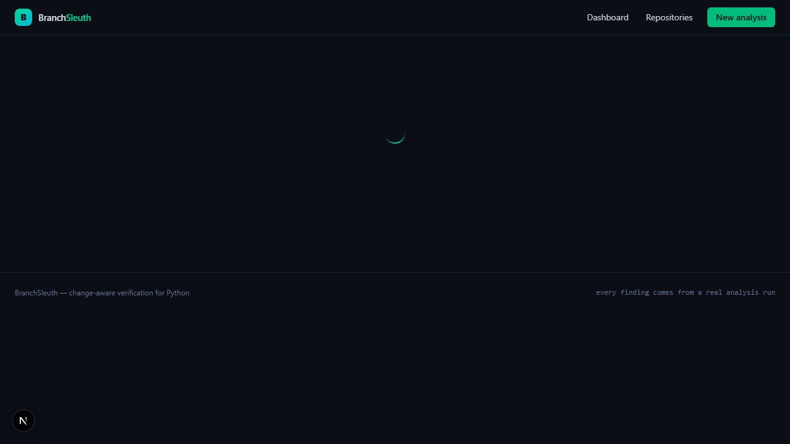
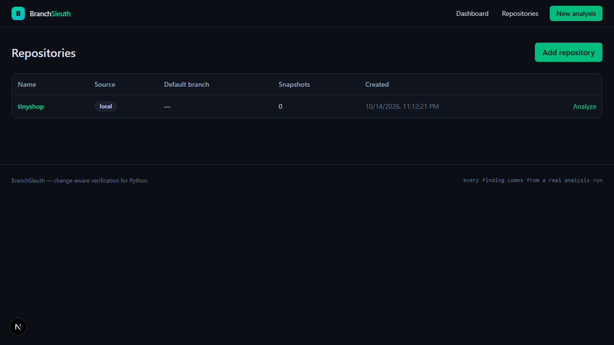
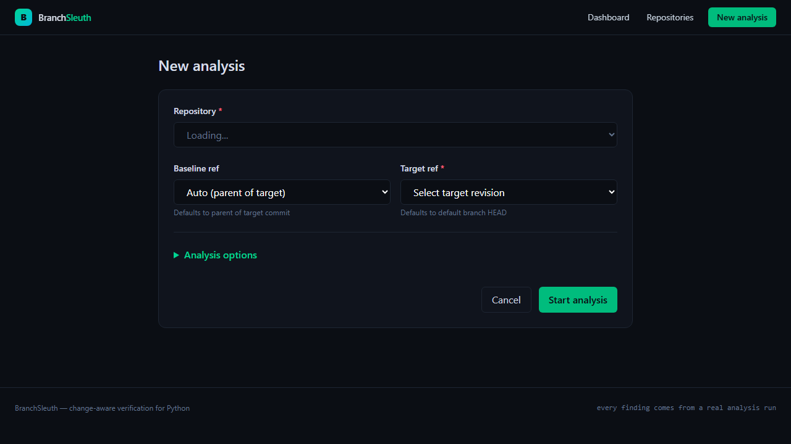
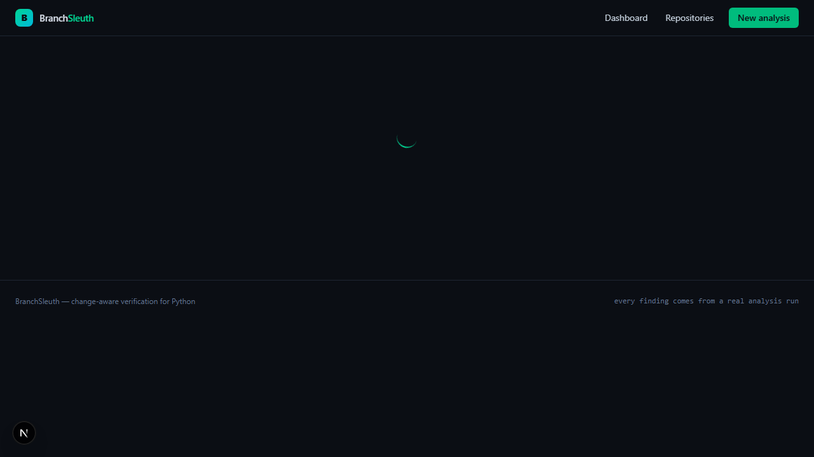
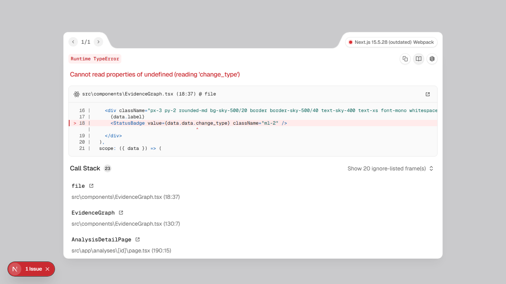
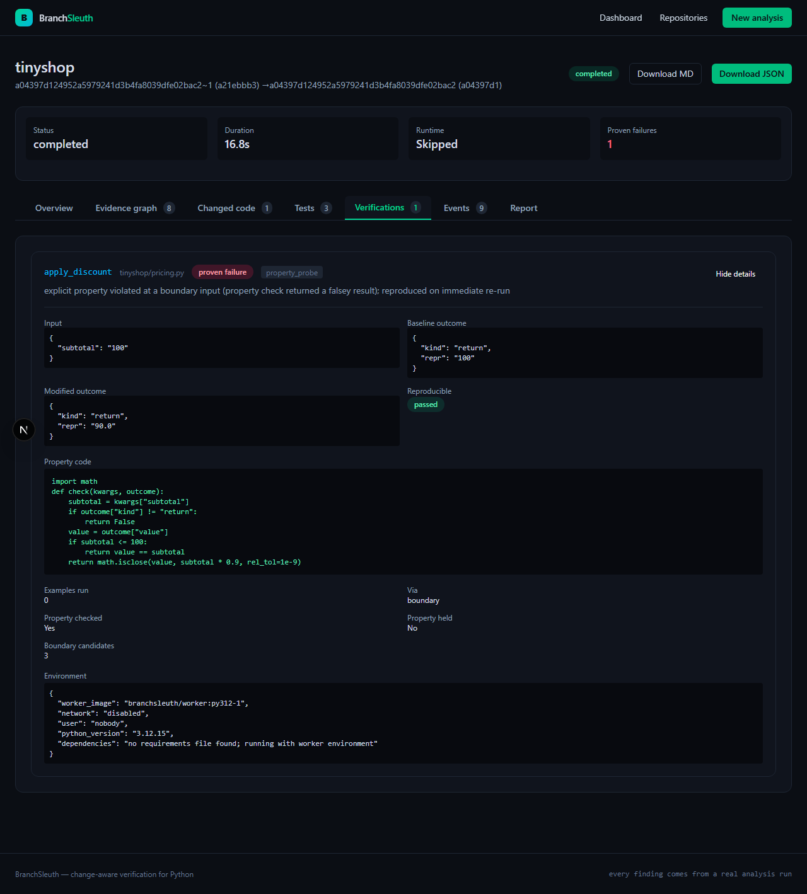
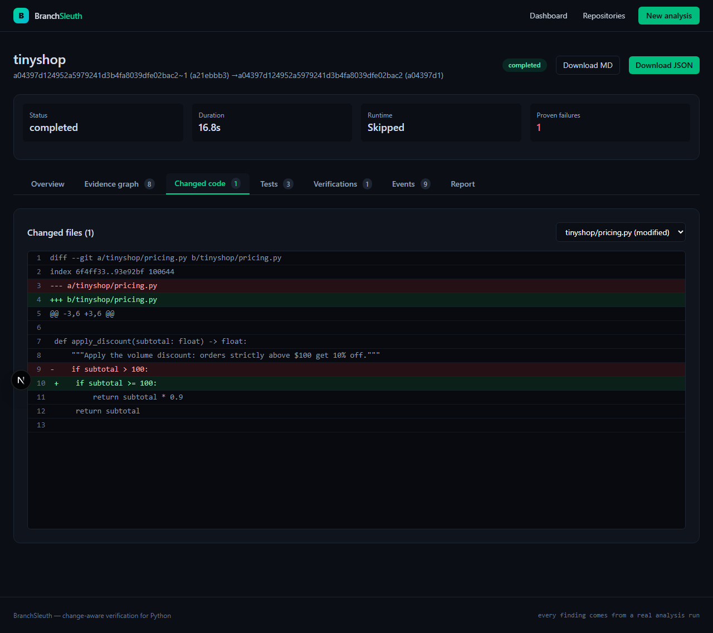

# BranchSleuth - Find the bugs your tests miss

Change-aware software verification and regression analysis for Python repositories.

## The Problem

When you change code, your test suite might pass but still miss bugs. Traditional coverage tells you which lines were executed, not whether the *changed* lines were actually verified. A passing test suite gives false confidence when the modifications you made lack dedicated verification.

## The Solution

BranchSleuth analyzes Git diffs, maps changes to executable scopes, runs tests in isolated containers with per-test coverage, and uses Hypothesis for targeted property-based verification of modified functions. It produces an evidence graph linking every finding to code, tests, and execution records.

## Target Users

- Python developers who want confidence that their changes don't introduce regressions
- Teams practicing continuous integration who need automated change verification
- Security engineers auditing code modifications for behavioral divergences

## Core Features

- **Repository ingestion**: HTTPS Git URLs, ZIP uploads, or local paths (dev mode)
- **Change analysis**: Unified diff parsing + Python AST to identify changed functions/classes and executable lines
- **Test attribution**: pytest with `--cov-context=test` maps each test to the changed lines it executes
- **Baseline vs modified execution**: Both revisions run in equivalent isolated Docker containers
- **Targeted verification**: Hypothesis property probes and boundary testing on changed functions
- **Evidence classifications**: PROVEN_FAILURE, BEHAVIOR_DIVERGENCE, UNVERIFIED_RISK, VERIFIED_CHECK_PASSED, INCONCLUSIVE, BASELINE_FAILURE
- **Evidence graph**: React Flow visualization connecting repository, files, scopes, tests, verifications, and confirmed failures
- **Reports**: Downloadable Markdown and JSON with full evidence trace

## Architecture

```
┌─────────────┐     ┌──────────────┐     ┌─────────────────┐
│  Frontend   │────▶│  FastAPI     │────▶│  Job Queue      │
│  (Next.js)  │     │  Backend     │     │  (PostgreSQL)   │
└─────────────┘     └──────────────┘     └────────┬────────┘
                          │                       │
                          ▼                       ▼
                   ┌──────────────┐     ┌─────────────────┐
                   │  Docker      │     │  Neon           │
                   │  Worker      │────▶│  PostgreSQL     │
                   │  (isolated)  │     │  (persistence)  │
                   └──────────────┘     └─────────────────┘
```

**Data flow**:
1. User submits repository + baseline/target refs via frontend
2. API creates AnalysisRun (queued) in Neon PostgreSQL
3. Background worker claims job, resolves Git revisions, extracts snapshots
4. Diff parsed, Python AST maps changed lines to function/class scopes
5. Docker worker prepares environment (installs deps wheel-only, no network)
6. Baseline and modified test suites run in separate isolated containers with coverage
7. Per-test coverage mapped to changed lines; uncovered changed lines identified
8. Hypothesis probes execute on changed functions (boundary + property-based)
9. Results classified, evidence graph built, summary stored in database
10. Frontend polls for completion, displays dashboard, evidence graph, diff viewer, test table, verification cards

## Technology Stack

- **Backend**: Python 3.12, FastAPI, SQLAlchemy 2.0, Alembic, pytest, coverage.py, Hypothesis
- **Frontend**: Next.js 15, React 19, TypeScript, Tailwind CSS 4, @xyflow/react
- **Database**: Neon PostgreSQL (Lakebase)
- **Runtime**: Docker containers (non-root, no-new-privileges, network disabled, resource limits)
- **Infrastructure**: Self-hosted or cloud, single binary deployment via Docker Compose

## Screenshots

### Dashboard


### Repositories


### New Analysis Wizard


### Analysis Results Overview


### Evidence Graph


### Verification Details


### Regression Evidence (Diff Viewer)


## Setup (Windows PowerShell)

### Prerequisites
- Python 3.12+
- Node.js 22+
- Docker Desktop (running)
- Neon PostgreSQL project (or local Postgres)

### Backend
```powershell
cd backend
python -m venv .venv
.\.venv\Scripts\Activate.ps1
pip install -r requirements.txt
cp ..\.env.example ..\.env
# Edit .env with your DATABASE_URL and settings
.\.venv\Scripts\python -m alembic upgrade head
.\.venv\Scripts\python -m uvicorn app.main:app --host 127.0.0.1 --port 8010
```

### Frontend
```powershell
cd frontend
npm install
# Create .env.local with BACKEND_URL=http://127.0.0.1:8010
npm run dev
```

### Worker Image
```powershell
docker build -t branchsleuth/worker:py312-1 -f docker/worker.Dockerfile docker/
```

### Run Background Worker
```powershell
cd backend
.\.venv\Scripts\python -m app.jobs.worker
```

## Environment Variables

| Variable | Description |
|----------|-------------|
| DATABASE_URL | PostgreSQL connection string (Neon or local) |
| BS_API_KEY | Optional API key for request authentication |
| BS_ALLOWED_GIT_HOSTS | Comma-separated allowed git hosts |
| BS_DATA_DIR | Local directory for repository data and artifacts |
| BS_ALLOW_LOCAL_REPOS | Allow local filesystem repositories (dev only) |
| BS_CONTAINER_MEM_BYTES | Memory limit for verification containers |
| BS_CONTAINER_CPUS | CPU limit for verification containers |
| BS_DEPS_TIMEOUT_SECONDS | Dependency installation timeout |
| BS_TESTS_TIMEOUT_SECONDS | Test execution timeout |
| BS_PROBE_TIMEOUT_SECONDS | Hypothesis probe timeout |
| BS_HYPOTHESIS_MAX_EXAMPLES | Max Hypothesis examples per target |
| BS_HYPOTHESIS_DEADLINE_MS | Hypothesis deadline per example |
| BS_CORS_ORIGINS | Allowed CORS origins for frontend |
| BS_AI_GATEWAY_URL | Optional LLM gateway URL |
| BS_AI_GATEWAY_KEY | Optional LLM gateway key |

## Neon Database Setup

1. Create a Neon project at https://console.neon.tech
2. Copy the connection string (pooled) to `DATABASE_URL` in `.env`
3. Run migrations: `cd backend && .\.venv\Scripts\python -m alembic upgrade head`

The schema includes tables for workspaces, repositories, snapshots, analysis runs, changed files, scopes, test records, verification attempts, artifacts, and job events.

## Example Analysis Workflow

1. **Add repository**: `POST /api/v1/repositories` with GitHub HTTPS URL or local path
2. **List refs**: `GET /api/v1/repositories/{id}/refs` to see branches/tags
3. **Start analysis**: `POST /api/v1/analyses` with repository_id, baseline_ref, target_ref, options
4. **Monitor progress**: `GET /api/v1/analyses/{run_id}` shows stage and detail
5. **View results**: `GET /api/v1/analyses/{run_id}` for summary, tabs for graph, diff, tests, verifications, events
6. **Download report**: `GET /api/v1/analyses/{run_id}/report?format=md` or `json`

## Evidence Classifications

| Classification | Meaning |
|----------------|---------|
| PROVEN_FAILURE | Reproducible violation of an explicit property or check |
| BEHAVIOR_DIVERGENCE | Baseline and modified behavior differ; no oracle to judge correctness |
| UNVERIFIED_RISK | Changed code lacks sufficient test coverage or verification |
| VERIFIED_CHECK_PASSED | A specific property/check passed for the modified code |
| INCONCLUSIVE | Verification could not establish an outcome |
| BASELINE_FAILURE | The failure also exists in the baseline revision |

Only PROVEN_FAILURE indicates a confirmed regression with reproducible evidence.

## Security Boundaries

- **Repository ingestion**: No code execution during clone/extract; SSRF-safe URL validation; size and file count limits
- **Docker worker**: Non-root user (65534), all capabilities dropped, `no-new-privileges`, network disabled, pids limit, tmpfs, CPU/memory limits, bounded logs/output
- **Secrets**: DATABASE_URL and API keys only on backend; never exposed to frontend, worker containers, or logs
- **Dependency preparation**: Wheel-only pip install in separate container phase; network disabled during test/probe phases

## Supported Repository Types

- Public HTTPS Git repositories (GitHub, GitLab, Bitbucket)
- ZIP uploads (max 50MB, no nested archives)
- Local filesystem paths (dev mode only, requires `BS_ALLOW_LOCAL_REPOS=true`)

## Limitations & Future Work

- Python-only analysis (AST parsing, pytest, Hypothesis)
- No support for private Git repositories with authentication yet
- Single-worker job processing (horizontal scaling via multiple workers planned)
- No built-in authentication UI (API key or external IdP required for production)
- Hypothesis probes limited to functions with inferrable strategies (int, float, bool, text, list)
- Property language restricted to Python `check(kwargs, outcome)` functions

## Verified Testing Results

- Backend unit + security + integration tests: 70 passed
- Frontend production build: passes
- Frontend TypeScript typecheck: passes
- End-to-end regression reproduction: verified with tinyshop fixture (PROVEN_FAILURE detected)
- Docker worker isolation: validated (non-root, network disabled, resource limits enforced)
- Neon PostgreSQL persistence: verified (schema migrations, analysis records, evidence graph)

## Links

- GitHub Repository: https://github.com/FlashSpeedie/BranchSleuth
- Live Demo: (deploy to your infrastructure)

---

*BranchSleuth - every finding comes from a real analysis run*